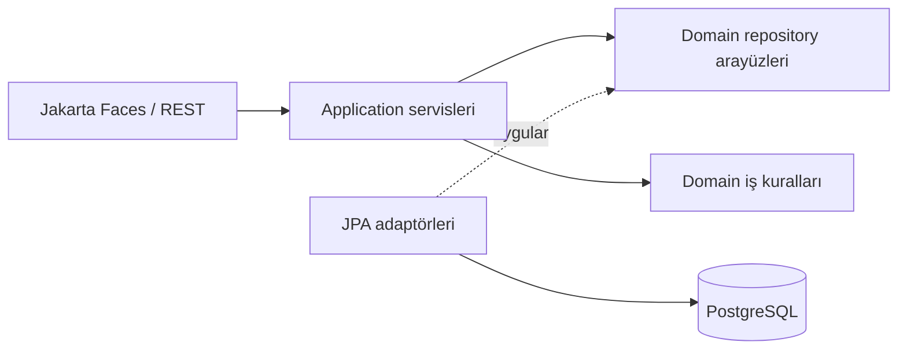
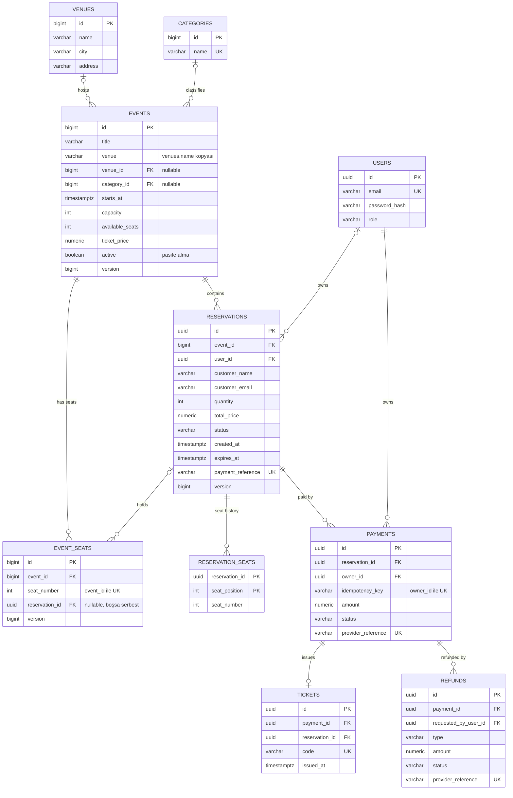

# Mimari ve işlem sınırları

Tek Maven WAR içinde katmanlı bir monolit seçildi. Altı kişinin geliştirmesine yetecek ayrım sağlanırken dağıtık servis ve ayrı deployment karmaşıklığı eklenmez.

`domain` sadece iş modeli, iş hatası ve repository sözleşmelerini içerir. JPA anotasyonları burada tutulur; bu saf bir framework bağımsız domain iddiası değildir. `application` kullanım senaryolarını ve `@Transactional` sınırını yönetir. `infrastructure` veri erişimini uygular. `presentation` DTO/form eşlemesi ve HTTP/ekran davranışını yönetir; entity'ler doğrudan JSON'a verilmez.

## SOLID karşılıkları

| İlke | Somut uygulama |
|---|---|
| S | Kontenjan kuralı `Event`, rezervasyon akışı `ReservationService`, JPA erişimi ayrı adaptör |
| O | Gelecekte ödeme sağlayıcısı domain portunu uygulayan yeni adaptörle eklenir; checkout sağlayıcıya bağlanmaz |
| L | Repository uygulamaları aynı `Optional` ve kilitleme sözleşmesini sağlamalı; bulunamayan kayıt `null` sızdırmaz |
| I | Etkinlik ve rezervasyon repository'leri küçük ve farklı sözleşmelere sahip; genel amaçlı dev bir repository yok |
| D | Servisler constructor injection ile arayüz alır; testler veritabanı olmadan fake/mock uygulamalarla çalışır |

OCP'nin ödeme örneği geliştirme planıdır; ödeme modülü henüz yazılmadı. Mimari testleri domain/application katmanlarının dış katmanlara, sunumun da JPA'ya bağımlı olmasını engeller.

## Rezervasyon transaction'ı

1. CDI proxy'si `ReservationService.create` çağrısını JTA transaction içinde başlatır.
2. Etkinlik `PESSIMISTIC_WRITE` ile okunur. PostgreSQL'de aynı etkinliğin kontenjan değişiklikleri sıraya girer.
3. Süresi dolmuş tutmalar bırakılır; adet, müşteri, etkinlik tarihi, kontenjan ve seçilen koltuklar doğrulanır.
4. Fiyat veri tabanındaki etkinlik fiyatından hesaplanır; istemci fiyat göndermez.
5. Kontenjan azaltılır; rezervasyon ve seçilen koltuk geçmişi persist edilir, canlı koltuklar rezervasyona atanır.
6. Metot başarıyla biterse container commit eder; herhangi bir exception'da `rollbackOn = Exception.class` tüm değişiklikleri geri alır.

Oluşturma, iptal, süre aşımı ve ödeme/iade callback'lerinin ortak kilit sırası **etkinlik → rezervasyon → koltuk** şeklindedir. Sahiplik/etkinlik kimliği önce entity yüklemeyen bir scalar sorguyla çözülür; böylece beklemeden önce yüklenmiş eski rezervasyon durumu kullanılmaz. Aynı rezervasyonun ikinci iptali `CONFLICT` üretir. Ödenmiş rezervasyon iptali `REFUND_PENDING` olur ve ödeme modülü iadeyi onaylamadan stok açılmaz. Çoklu etkinlik/sepet özelliği eklenirse etkinlikler için de sıralı kilitleme tasarlanmalıdır.

Payara `ReservationExpiryJob` her 10 saniyede en fazla 100 aday tarar; her aday `REQUIRES_NEW` transaction içinde işlenir. Tek bir hatalı aday diğerlerinin commit'ini geri almaz. Zamanlayıcı gecikse bile oluşturma, koltuk listesi ve tekil rezervasyon sorgusu süresi dolmuş tutmaları uzlaştırabilir. Durum diyagramı, canlı tahsis/geçmiş ayrımı ve migration: [RESERVATIONS.md](RESERVATIONS.md).

`@Version` ek bir tutarlılık kontrolüdür; fazla satışın asıl koruması kontenjan kontrolüyle birlikte pessimistic lock'tur. İkinci seviye cache kapalıdır. JVM içi `synchronized` kullanılmaz; veritabanı kilidi birden fazla uygulama instance'ında da geçerlidir.

Unit testler domain/servis kurallarını doğrular; JTA'nın gerçekten rollback yaptığını unit test mock'ları ispatlamaz. `scripts/smoke_test.py`, gerçek Payara ve PostgreSQL üzerinde başarısız kayıt sonrası kontenjanı ve rezervasyon tablosunu kontrol eder.

## Veri modeli

Zamanlar UTC `Instant`, para TL cinsinden `BigDecimal` olarak tutulur. `006` migration'ı canlı tahsis için `event_seats`, seçim geçmişi için `reservation_seats` ve rezervasyon süre/ödeme alanlarını ekler. Canlı etkinlik/koltuk çifti benzersizdir; geçmiş kayıtlar koltuğun yeniden kullanılmasını engellemez. `007` ve `008` migration'ları ödeme, bilet ve iade tablolarını (Üye 4) ekler.

**Katalog (Üye 2):** `003` migration'ı `venues` ve `categories` tablolarını, `events.venue_id` ve `events.category_id` sütunlarını ekler. İkisi de boş olabilir; böylece eski etkinlikler ve metin olan `events.venue` sütunu çalışmaya devam eder. Yönetim API'si etkinlik kaydederken `events.venue` metnini seçilen mekânın adından doldurur. `009` migration'ı `events.active` sütununu ekler: etkinlikler silinmez, pasife alınır; rezervasyon, ödeme ve bilet geçmişi bu yüzden korunur (`reservations.event_id` yabancı anahtarı silmeyi zaten engeller). Katalog sorguları yalnız `active = true` ve gelecekte başlayan etkinlikleri sabit sırayla (`starts_at`, `id`) döner; arama parametreleri [API sözleşmesinde](API.md) açıklanmıştır.

## Kimlik, roller ve rezervasyon sahipliği

`CurrentAccount` oturum özetini, Jakarta Security principal adını ve container rolünü eşleştirir. REST filtresi kimlik ve CSRF kontrolünü istek gövdesi doğrulamasından önce yapar. Faces formu aynı oturum belirtecini gizli alandan doğrular. Her iki giriş noktası servise aynı güvenilir kullanıcı UUID’sini iletir.

`ReservationService.create(userId, command)` sahipliği yeni kayda yazar. `find(userId, id)` ve `cancel(userId, id)` için repository `id` ve `userId` koşullarını birlikte kullanır. Sahip eşleşmezse yalnızca kaydın varlığı sınanır; kişisel alanlar okunmaz. Varlığı bilinen yabancı kayıt 403, kayıp kayıt 404 üretir. İzin reddi stok veya durum güncellenmeden önce gerçekleşir. Sayfalı liste de güvenilir kullanıcı kimliğine göre filtrelenir.

Üye 1 için dört dakikalık demo: ilk dakika kayıt ve tekrar kayıt; ikinci dakika giriş, oturum ve `/me`; üçüncü dakika iki hesapla rezervasyon ve başka sahibin 403 yanıtı; son dakika yetkili iptal, stok iadesi ve çıkış. Yönetim CRUD demosu Üye 2’nin uçlarıyla tamamlanacaktır.
