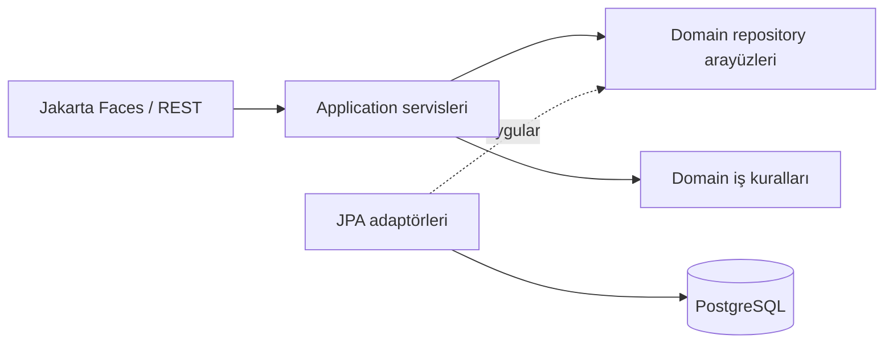
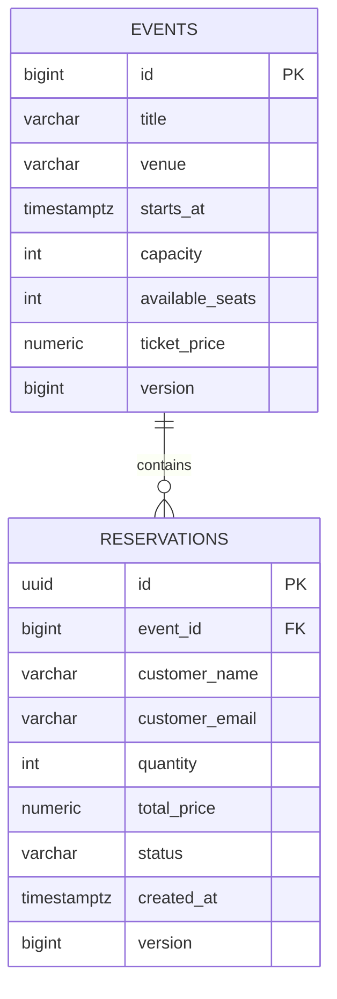

# Mimari ve işlem sınırları

Tek Maven WAR içinde katmanlı bir monolit seçildi. Altı kişinin geliştirmesine yetecek ayrım sağlanırken dağıtık servis ve ayrı deployment karmaşıklığı eklenmez.

`domain` sadece iş modeli, iş hatası ve repository sözleşmelerini içerir. JPA anotasyonları burada tutulur; bu saf bir framework bağımsız domain iddiası değildir. `application` kullanım senaryolarını ve `@Transactional` sınırını yönetir. `infrastructure` veri erişimini uygular. `presentation` DTO/form eşlemesi ve HTTP/ekran davranışını yönetir; entity'ler doğrudan JSON'a verilmez.

## SOLID karşılıkları

| İlke | Somut uygulama |
|---|---|
| S | Kontenjan kuralı `Event`, rezervasyon akışı `ReservationService`, JPA erişimi ayrı adaptör |
| O | Gelecekte ödeme sağlayıcısı domain portunu uygulayan yeni adaptörle eklenir; checkout sağlayıcıya bağlanmaz |
| L | Repository uygulamaları aynı `Optional` ve kilitleme sözleşmesini sağlamalı; bulunamayan kayıt `null` sızdırmaz |
| I | Etkinlik ve rezervasyon repository'leri küçük ve farklı sözleşmelere sahip; genel amaçlı dev bir repository yok |
| D | Servisler constructor injection ile arayüz alır; testler veritabanı olmadan fake/mock uygulamalarla çalışır |

OCP'nin ödeme örneği geliştirme planıdır; ödeme modülü henüz yazılmadı. Mimari testleri domain/application katmanlarının dış katmanlara, sunumun da JPA'ya bağımlı olmasını engeller.

## Rezervasyon transaction'ı

1. CDI proxy'si `ReservationService.create` çağrısını JTA transaction içinde başlatır.
2. Etkinlik `PESSIMISTIC_WRITE` ile okunur. PostgreSQL'de aynı etkinliğin kontenjan değişiklikleri sıraya girer.
3. Adet, müşteri bilgisi, etkinlik tarihi ve kontenjan doğrulanır.
4. Fiyat veri tabanındaki etkinlik fiyatından hesaplanır; istemci fiyat göndermez.
5. Entity üzerindeki kontenjan azaltılır; rezervasyon persist edilip flush edilir.
6. Metot başarıyla biterse container commit eder; herhangi bir exception'da `rollbackOn = Exception.class` ikisini de geri alır.

İptalde önce mevcut rezervasyon, sonra etkinlik kilitlenir. Aynı rezervasyonun ikinci iptali `CONFLICT` üretir. Oluşturma mevcut bir rezervasyonu kilitlemediğinden bu akışta ters yönde kilit döngüsü oluşmaz. Çoklu etkinlik/sepet özelliği eklenirse tüm etkinlikler için ortak sıralı kilitleme tasarlanmalıdır.

`@Version` ek bir tutarlılık kontrolüdür; fazla satışın asıl koruması kontenjan kontrolüyle birlikte pessimistic lock'tur. İkinci seviye cache kapalıdır. JVM içi `synchronized` kullanılmaz; veritabanı kilidi birden fazla uygulama instance'ında da geçerlidir.

Unit testler domain/servis kurallarını doğrular; JTA'nın gerçekten rollback yaptığını unit test mock'ları ispatlamaz. `scripts/smoke_test.py`, gerçek Payara ve PostgreSQL üzerinde başarısız kayıt sonrası kontenjanı ve rezervasyon tablosunu kontrol eder.

## Veri modeli

Zamanlar UTC `Instant`, para TL cinsinden `BigDecimal` olarak tutulur. Ödeme eklenirken `Payment`, `Ticket` ve kullanıcı/koltuk tabloları sürümlü migration ile eklenir. Mevcut kontenjan modeli numaralı koltuk seçimi sunmaz.
