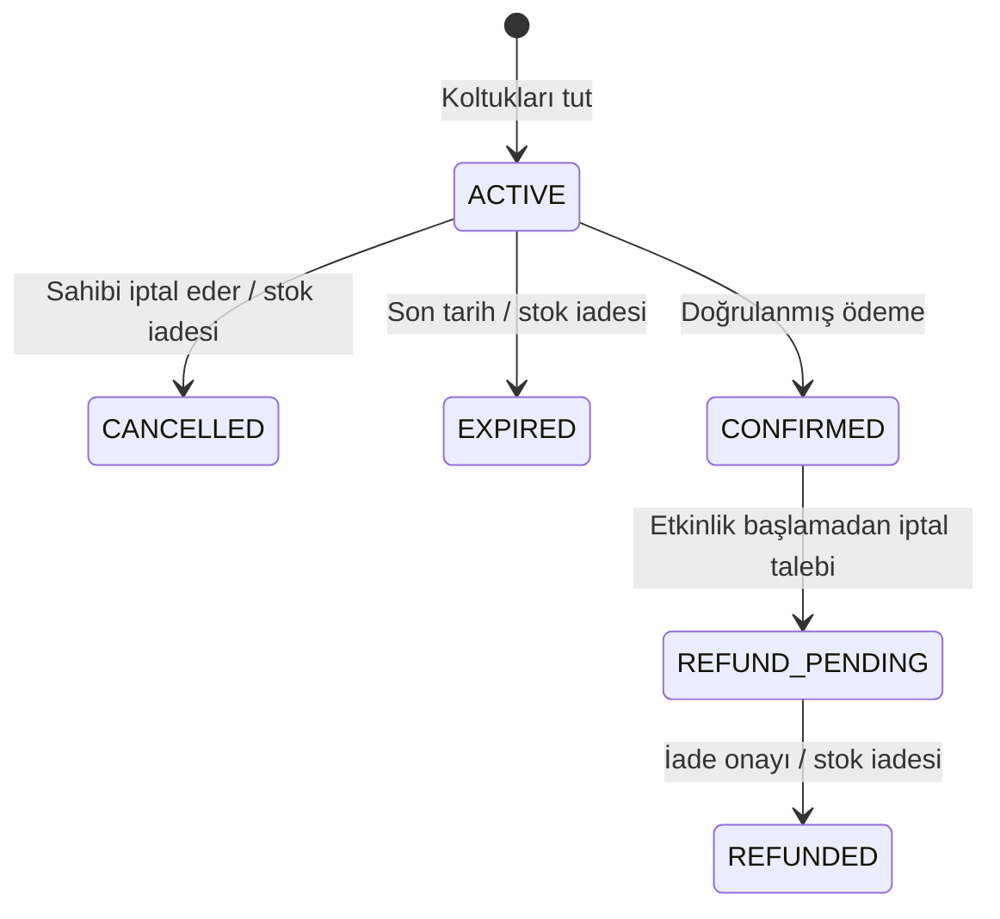
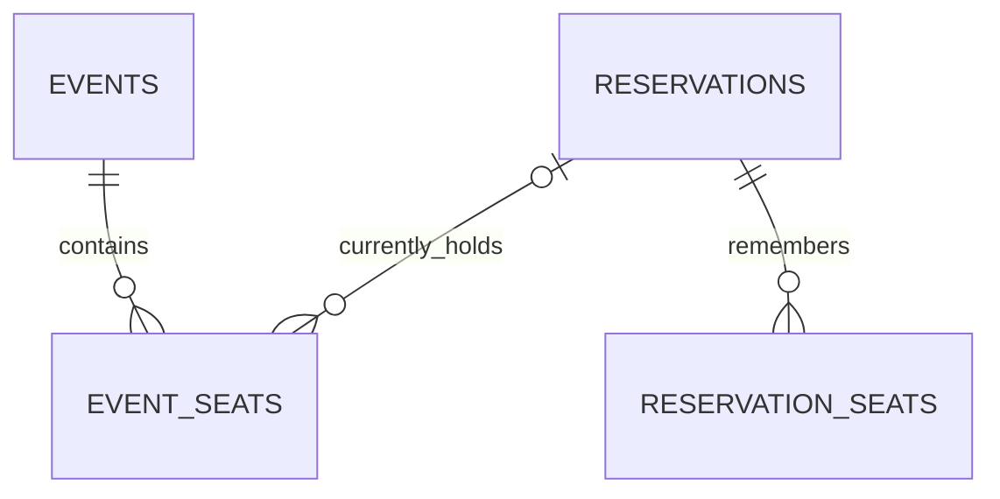

# Üye 3 — Rezervasyon ve numaralı koltuklar

Mevcut kullanıcı/session/rol altyapısına bağlanır. Kullanıcı kimliği JSON'dan alınmaz; `CurrentAccount` tarafından doğrulanan session ve container principal'ından gelir. ADMIN dahil kullanıcılar yalnız kendi rezervasyonlarını listeler, okur ve iptal eder. Yazma isteklerinde oturuma ait güncel `X-CSRF-Token` gerekir.

## API

| Metot | Uç | Davranış |
|---|---|---|
| GET | `/api/events/1/seats` | Herkese açık, `[{"number":1,"available":true}, …]`; kişi/rezervasyon kimliği içermez |
| POST | `/api/reservations` | Belirli veya otomatik seçilen koltukları süreli tutar |
| GET | `/api/reservations?page=0&size=20` | Yalnız oturum sahibinin rezervasyonlarını en yeni başta listeler |
| GET | `/api/reservations/{uuid}` | Sahibinin rezervasyonunu okur; tutma süresi geçmişse serbest bırakır |
| POST | `/api/reservations/{uuid}/cancel` | Ödenmemiş tutmayı iptal eder; ödenmiş kayıtta iade beklemeye geçer |

Örnek istek:

```json
{
  "eventId": 1,
  "customerName": "Ada Yılmaz",
  "customerEmail": "ada@example.com",
  "quantity": 2,
  "seatNumbers": [1, 3]
}
```

`seatNumbers` isteğe bağlıdır. Verilmezse ya da boş liste ise uygun ilk `quantity` koltuk atanır; eski Faces formu ve istemciler bu şekilde çalışmaya devam eder. Seçim verilirse 1–10 farklı pozitif sayı içermeli, adetle eşleşmeli ve koltuklar ilgili etkinlikte bulunmalıdır. Seçim/adet hatası `400`, dolu koltuk veya yetersiz kontenjan `409` döndürür. Fiyatı sunucu belirler.

Başarı (`201` ve `Location`):

```json
{
  "id": "2aeb5165-f9ec-46c3-942d-0f698ac7221e",
  "eventId": 1,
  "quantity": 2,
  "totalPrice": 700.00,
  "status": "ACTIVE",
  "createdAt": "2030-01-01T12:00:00Z",
  "expiresAt": "2030-01-01T12:15:00Z",
  "seatNumbers": [1, 3]
}
```

Sayfalama `page` için 0 tabanlıdır; `size` 1–100 arasındadır. Çarpımı Java `int` aralığını aşan offset reddedilir. Yanıt `items`, `page`, `size`, `totalElements`, `totalPages` içerir. Sıralama `createdAt DESC, id DESC` şeklinde kararlıdır. Son sayfadan sonraki istek boş `items` döndürür; başka kullanıcının kimliğini sorguya eklemek sahipliği değiştirmez.

## Tutma süresi ve durumlar

`ACTIVE`, ödeme bekleyen tutmadır. Son tarih `min(oluşturma + 15 dakika, etkinlik başlangıcı)` olarak hesaplanır. Tam son tarihte ödeme kabul edilmez. Tarihler UTC `Instant`, para `BigDecimal` olarak tutulur.



`CONFIRMED` ve `REFUND_PENDING` koltukları tutmaya devam eder; son tarih onları otomatik iptal etmez. İade başarısız veya beklemedeyken koltuk ikinci müşteriye verilmez. İade onayı sonradan, etkinlik başladıktan sonra gelse bile daha önce kabul edilmiş iadenin stok uzlaştırması tamamlanabilir. Yeni iptal talebi etkinlik başladıktan sonra kabul edilmez.

`ReservationExpiryJob` her 10 saniyede en fazla 100 süresi geçmiş aday tarar. Her aday ayrı `REQUIRES_NEW` transaction ile işlenir. Oluşturma, koltuk sorgusu ve tekil rezervasyon sorgusu zamanlayıcı gecikmişse ilgili süresi dolmuş tutmaları da uzlaştırır. Sayfalı listede durum zamanlayıcının taramasına kadar gecikebilir; `expiresAt` ödeme için kesin sınırdır.

Süresi dolmuş `ACTIVE` kaydın iptal isteği o çağrıda ilk kez uzlaştırılıyorsa `200 EXPIRED` döner ve transaction commit olur. Sonraki iptal `409` verir. Uzlaştırmadan sonra exception atılıp yapılan stok iadesinin rollback olması önlenir. `CANCELLED`, `EXPIRED` ve `REFUNDED` durumlarında ikinci kez stok iade edilmez.

## Transaction ve kilit sırası

Tüm yazma yolları aynı sırayı izler: **etkinlik → rezervasyon → koltuk**. Önce sahiplik/etkinlik kimliği scalar sorgu ile bulunur; beklemeden önce mutable rezervasyon entity'si yüklenmez. Her iki kullanıcı aynı son koltuğu seçerse etkinlik kilidi işlemleri sıraya alır; ikincisi güncel doluluk üzerinden `409` alır. Koltuk satırları da `PESSIMISTIC_WRITE` ile alınır.

Oluşturmada kontenjan azaltımı, rezervasyon, seçim geçmişi ve canlı koltuk tahsisi tek JTA transaction içindedir. İptal/süre aşımı/iade tamamlamada durum, canlı koltuk boşaltma ve kontenjan iadesi birlikte commit edilir. Tahsis sayısı rezervasyon adediyle uyuşmazsa işlem rollback olur. `@Version` ek bir tutarlılık denetimidir.

JPA adaptörü tahsis/bırakma yazmalarını servis dönmeden flush eder. SQL hataları yalnız container commit aşamasına bırakılmaz; transaction geri alınırken REST hata eşleyicisi tutarlı JSON yanıt üretebilir.



- `event_seats`: etkinlik/koltuk çifti `UNIQUE`; bir koltuk satırında aynı anda tek `reservation_id` bulunur.
- `reservation_seats`: rezervasyonun değişmeyen seçim geçmişi. İptalden sonra aynı koltuğun yeniden tutulmasını engellemez.
- `reservations`: süre, durum ve benzersiz ödeme referansı. Veritabanı durum/referans ve son tarih kurallarını da denetler.

Payara PostgreSQL veri kaynağında `stringType=unspecified` kullanılır. Böylece EclipseLink'in JDBC `VARCHAR` olarak bağladığı boş UUID parametrelerinin türünü PostgreSQL hedef sütundan çıkarır; hazırlanmış ifadeler kullanılmaya devam eder. [pgJDBC sürücü ayarı](https://pgjdbc.github.io/pgjdbcdocs/documentation/use/)

Stok eşitliği: `capacity = available_seats + canlı tahsis sayısı`. Canlı tahsisler `ACTIVE`, `CONFIRMED` ve `REFUND_PENDING` rezervasyonlara aittir. Süresi geçmiş ama henüz uzlaştırılmamış `ACTIVE` kayıt, bırakılana kadar fiziksel tahsisini korur.

## Üye 4: ödeme ve iade bağlantısı

`application.port.ReservationCheckout` CDI ile inject edilebilir. Yalnız güvenilir sunucu içi ödeme modülü çağırır; müşterinin ödeme durumunu değiştirebileceği bir REST ucu eklenmedi.

```java
Reservation confirmed = checkout.confirmPayment(reservationId, gatewayPaymentId, chargedAmount);
Reservation refunded = checkout.completeRefund(reservationId, gatewayPaymentId);
```

- Onay tutarı sunucudaki toplamla aynı olmalıdır; referans 1–128 karakterdir ve DB'de benzersizdir.
- Aynı referans/tutarla tekrar onay aynı durumu korur; geç gelen onay iptal edilmiş/sona ermiş tutmayı canlandıramaz.
- Sahibi `CONFIRMED` kaydı iptal ettiğinde `REFUND_PENDING` döner. Üye 4 sağlayıcı iadesini doğruladıktan sonra **orijinal ödeme referansı** ile `completeRefund` çağırır.
- Tekrarlanan iade callback'i ikinci stok iadesi üretmez. Yanlış referans veya beklenmeyen durum reddedilir.
- Harici sağlayıcı JTA transaction'a katılmaz. Tahsilat sonrası tutma süresi bittiyse Üye 4 sağlayıcı tarafında telafi/iade yapmalı; başarısız yerel commit için retry/outbox ve sağlayıcı idempotency mekanizmasını tasarlamalıdır.

Bu modül para tahsil etmez, gerçek/sahte ödeme adaptörü veya bilet üretmez; bunlar Üye 4 kapsamındadır. Üye 5 görsel koltuk haritasını seat API'sine, müşteri rezervasyon listesini sayfalı API'ye bağlayabilir. Üye 2 kapasite değiştirirken mevcut numaralı koltuklar ve canlı tahsislerle uyumluluğu sağlamalıdır; kapasite küçültme bu modülün API'sine eklenmedi.

## Mevcut veritabanını yükseltme

Boş Compose volume üzerinde `001`–`006` otomatik uygulanır. Önceden `005` uygulanmış veritabanını yedekleyin, uygulamayı durdurun ve **yalnız 006'yı bir kez** uygulayın:

```powershell
docker compose stop app
docker compose exec -T db sh -c 'psql -X -v ON_ERROR_STOP=1 -U "$POSTGRES_USER" -d "$POSTGRES_DB" -f /docker-entrypoint-initdb.d/006-seats-and-reservation-lifecycle.sql'
docker compose up -d --build app
```

`006` kendi `BEGIN`/`COMMIT` sınırını içerir. Mevcut stokla aktif rezervasyon adedi uyuşmazsa tüm migration geri alınır; veri sessizce düzeltilmez. Mevcut aktif rezervasyonlara çakışmayan koltuk aralıkları atanır. Kullanıcısı bilinen aktif kayıtlara yükseltme anından itibaren en fazla 15 dakikalık son tarih verilir. `005`'in koruduğu anonim eski kayıtlar sahiplik veya süre açısından değiştirilmez ve erişilemez kalır. Önceki iptallerin bilinmeyen koltuk geçmişi uydurulmaz.

Sonradan oluşturulan etkinliğin koltukları, etkinlik kilidi altında ilk koltuk/rezervasyon sorgusunda hazırlanır. `docker compose down -v` yükseltme yöntemi değildir; mevcut veriyi korumak için migration kullanın.

## Doğrulama ve dört dakikalık demo

`mvnw verify` domain/servis, sahiplik, sayfalama, tam son tarihte ödeme reddi, iptal/iade tekrarı ve mimari testlerini; Checkstyle/SpotBugs denetimlerini çalıştırır. `python scripts/smoke_test.py`, mevcut auth testlerine ek olarak `reservation_smoke.py` üzerinden gerçek PostgreSQL/Payara'da şunları doğrular:

- Eski sahipli/anonim verilerle migration; tutarsız stokta migration'ın tamamen rollback olması.
- Kullanıcıya özel sayfalama ve anonim erişim reddi.
- İki kullanıcının aynı numaralı koltuk için yarışı; DB benzersizlik kısıtı.
- Yeniden atanan koltuğun eski sahibinin iptal isteğinden korunması.
- Süre aşımı/iptal yarışı ve HTTP çağrısı olmadan gerçek Payara timer'ı.
- Ödenmiş kayıtta iade beklerken stok korunması ve müşteriye ödeme callback ucu verilmemesi.
- Koltuk tahsisi ve bırakılması sırasında zorlanan DB hatalarında durum/kontenjan/tahsisin birlikte rollback olması.

Demo: ilk dakika iki kullanıcı ve kendi rezervasyon listeleri; ikinci dakika aynı koltuğa iki eşzamanlı istek; üçüncü dakika zamanlayıcıyla boşalan koltuk; son dakika durum diyagramı, ödeme/iade Java sözleşmesi ve rollback test kanıtı.
